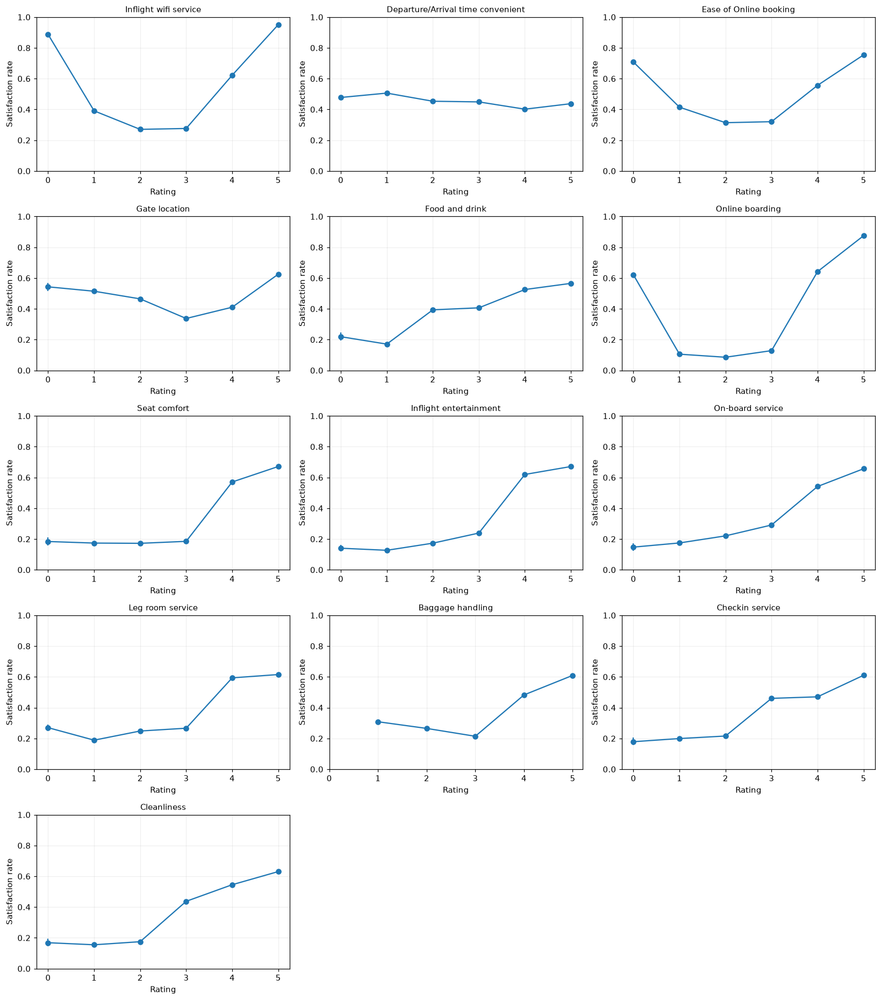
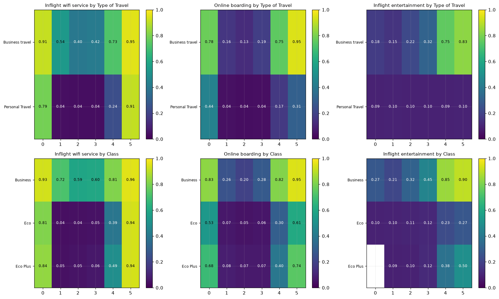
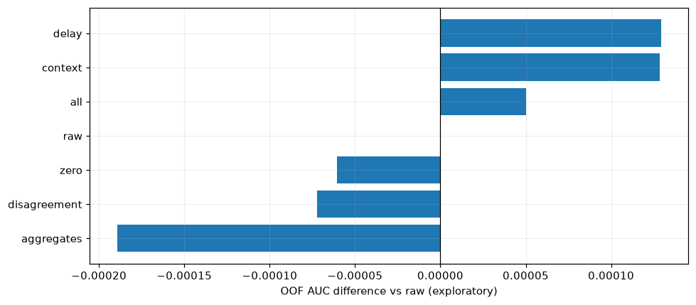

# S6E10 特徴量分析 — 初回結果

訓練699,635行・テスト299,844行を全件で分析しました。
欠損は到着遅延のみ（訓練292行、テスト130行）。目的変数はboolで、満足の割合は44.36%です。
元のノートブックは保持し、追加ノートブックに図・集計・実行結果を保存しています。

## 評価値の意味を一律に扱わない

- Wi-Fi評価0：13,102行、満足率88.73%。評価1の39.07%を上回ります。
- オンライン予約評価0：16,073行、満足率70.76%。評価1は41.46%。
- オンライン搭乗評価0：9,147行、満足率62.04%。評価1は10.53%。
- 「0＝該当なし/未利用」は仮説です。実際の意味をこの集計から断定しません。
- 多くの項目では評価3から4への差が大きく、全項目の単純平均では意味の違いが消えます。

候補は0フラグ、0の件数、0を除いた平均、低評価/高評価の件数。
ただし、木モデルは元の評価列だけで0を分岐できるため、派生列が必ず改善するわけではありません。

## 顧客層によって同じ評価の関連が違う

Business travelの満足率58.43%、Personal Travelは9.73%。
忠実顧客×業務旅行×Businessクラスでは79.18%、忠実顧客×個人旅行×Ecoは9.71%。
個人旅行の機内エンタメ評価は、値が変わっても満足率がおおむね10%のままです。
旅行目的やクラスと評価の組み合わせを候補にします。
これらは周辺/条件付き関連であり、因果効果や他の全特徴量を調整した効果ではありません。

## 評価の一致が強い関連を持つ

食事と清潔さの評価が一致：458,242行、満足率33.83%。異なる：241,393行、64.35%。
一方、機内サービスと荷物対応は一致で56.90%、異なると29.42%。
「一致＝よい/悪い」と一律には言えません。ペアごとの一致フラグ、差分、組み合わせカテゴリを比較します。
この差には各評価値・旅行目的などの構成差も含まれます。

## 訓練・テストの分布

調べた各列のJensen–Shannon divergenceは最大でも約0.0000103で、
各列単体で目立つ分布差は見られません。連続値は訓練分位点による区切りを使用しています。
これは同時分布や目的変数との関係が等しいことの証明ではありません。
IDは順序診断だけに使い、モデルの特徴量からは除外しました。
IDを除いた完全一致の重複行、および訓練・テスト間の特徴量一致は今回のハッシュ診断では0件でした。

## 特徴量群の追加比較

層化抽出120,000行・同じ3-fold、CatBoostの400木・深さ6・学習率0.08を固定。
各特徴量群を元の21列へ単独追加し、全候補追加とも比較しました。
ターゲットやIDを除き、派生量はすべてその行の説明変数だけで作成しています。
OOF AUCは各行が学習に使われていないfoldの予測から計算した値で、Kaggle提出スコアではありません。

| 追加する特徴量群 | OOF AUC | 基準との差 | foldごとの最小差 | foldごとの最大差 |
|---|---:|---:|---:|---:|
| 遅延の派生量 | 0.957541 | +0.000129 | -0.000137 | +0.000438 |
| 顧客層との組み合わせ | 0.957541 | +0.000128 | -0.000298 | +0.000504 |
| 全候補 | 0.957462 | +0.000050 | -0.000370 | +0.000591 |
| 元の列のみ | 0.957412 | +0.000000 | +0.000000 | +0.000000 |
| 0フラグ・0件数 | 0.957352 | -0.000061 | -0.000172 | +0.000133 |
| 評価の一致・差・ペア | 0.957340 | -0.000072 | -0.000113 | -0.000014 |
| 評価の集約 | 0.957223 | -0.000189 | -0.000551 | +0.000477 |

全foldで改善した群：該当なし。

全件EDAを見て候補を選んでいるので、この比較は探索用です。
小さな差は追加seed・全件・より強いモデルで再現するか確認してから採用します。
ここで悪化した群も、別のモデルで無効と断定しません。

## 再現方法

`requirements-analysis.txt` に実行環境のバージョンを記録。
データは `data/raw/`、出力CSV/画像/OOF予測は `reports/` に保存。
`analysis/features.py` の `model_frame` で同じ特徴量を訓練とテストに適用できます。
実行済みノートブックは `notebooks/feature_engineering/s6e10_feature_analysis.ipynb`。
